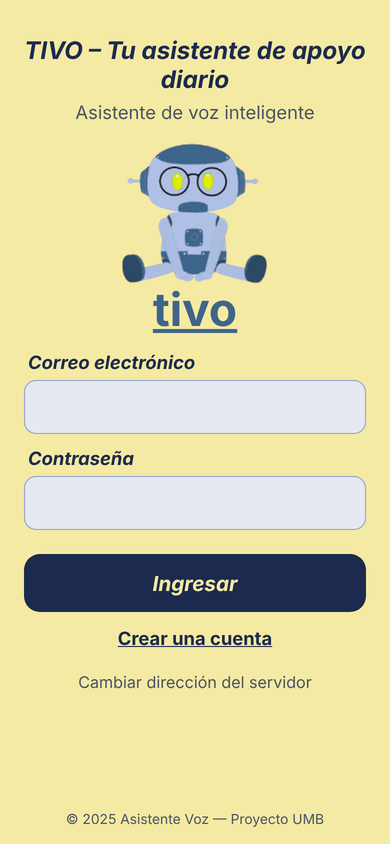
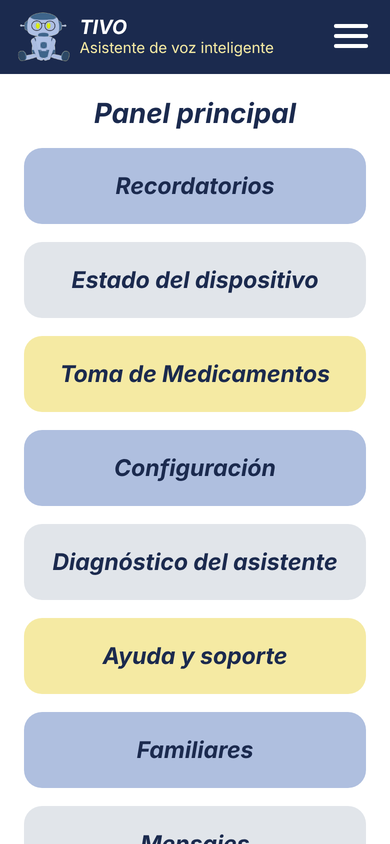
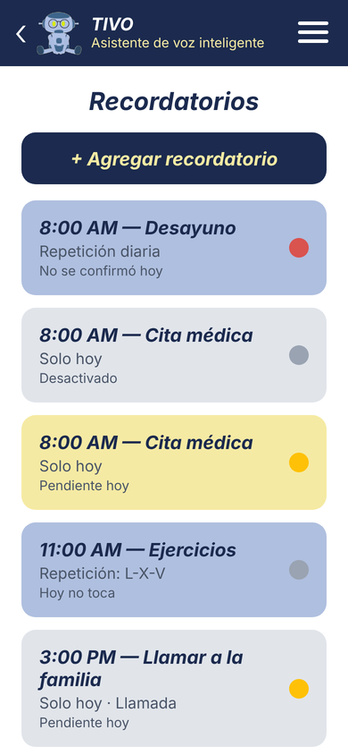
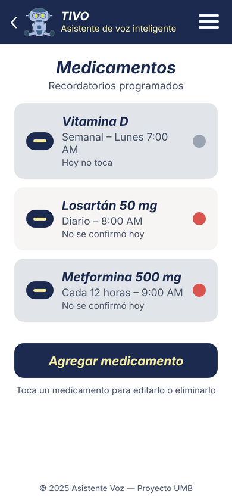
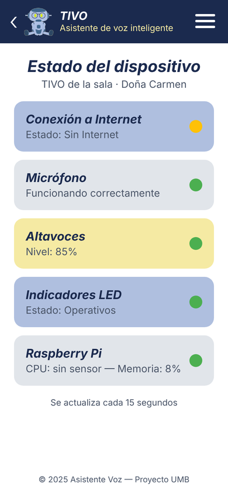

# TIVO — Asistente de voz para adultos mayores

Proyecto de grado de Ingeniería de Software (Universidad Manuela Beltrán). TIVO es un asistente de voz que vive en una Raspberry Pi y acompaña a una persona mayor: le recuerda sus medicamentos y tareas, le dice la hora, le lee mensajes de la familia y responde preguntas. Los familiares y cuidadores lo administran desde una app móvil.

El repositorio tiene las tres partes del sistema:

| Carpeta | Qué es | Tecnología |
|---|---|---|
| [`api/`](api) | API REST: cuentas, recordatorios, medicamentos, familiares, mensajes, estado y diagnóstico | Node.js, Express, SQLite |
| [`asistente/`](asistente) | Software del dispositivo: escucha, entiende, responde y avisa | Node.js, Vosk, ChatGPT |
| [`movil/`](movil) | App para familiares y cuidadores | React Native, Expo |
| [`compartido/`](compartido) | Cálculo de horarios que usan la API y el asistente | JavaScript |

```
 App móvil ──HTTPS──▶  API REST  ◀──HTTPS── Asistente (Raspberry Pi)
 (familiar)            (SQLite)             micrófono → Vosk → intenciones → voz
                                                              └→ ChatGPT (solo preguntas abiertas)
```

El asistente consulta la API cada 30 segundos y guarda una copia local, así los recordatorios siguen sonando aunque se caiga Internet. Lo que la persona cambie por voz sin conexión se envía cuando la red vuelve.

<p>
  
  
  
  
  
</p>

## Probarlo en el computador (10 minutos)

Requisito: [Node.js 22.13 o superior](https://nodejs.org). No hace falta micrófono ni Raspberry Pi: el asistente tiene un modo de texto.

**1. API**

```bash
cd api
npm install
npm run semilla     # crea datos de demostración y muestra el token del dispositivo
npm start           # queda en http://localhost:3000/api
```

`npm run semilla` crea la cuenta `demo@tivo.app` con contraseña `tivo1234` y muestra un **token del dispositivo**: cópielo.

**2. Asistente (modo texto)**

```bash
cd asistente
cp .env.example .env      # en Windows: copy .env.example .env
# pegue el token en TOKEN_DISPOSITIVO dentro de .env
npm run texto
```

Escriba, por ejemplo: `qué hora es`, `qué tengo para hoy`, `recuérdame tomar agua todos los días a las tres`, `cuál es el número de mi hijo`, `léeme los mensajes`. Para preguntas abiertas ("¿cuál es la capital de Francia?") ponga una clave de OpenAI en `OPENAI_API_KEY`.

**3. App móvil**

```bash
cd movil
npm install
npx expo start
```

Instale **Expo Go** en el teléfono y escanee el código QR. El teléfono y el computador deben estar en la misma red Wi-Fi. En la pantalla de ingreso toque *Cambiar dirección del servidor* y escriba la IP del computador, por ejemplo `http://192.168.1.20:3000`. Ingrese con la cuenta de demostración.

## Instalarlo en la Raspberry Pi

Pensado para una Raspberry Pi 4 o 5 con Raspberry Pi OS de 64 bits, un micrófono USB y un parlante.

```bash
git clone https://github.com/alejo7762-coder/tivo-asistente-voz.git
cd tivo-asistente-voz/asistente
bash despliegue/instalar-pi.sh      # instala Node.js, Vosk, el modelo de voz en español, espeak-ng y mpg123
nano .env                           # TOKEN_DISPOSITIVO, URL_API, ENTRADA_VOZ=vosk, SALIDA_VOZ=espeak
npm start
```

Para que arranque solo al encender y se reinicie si falla:

```bash
sudo cp despliegue/tivo.service /etc/systemd/system/
sudo systemctl enable --now tivo
```

- **Registrar un dispositivo real:** en el servidor, `cd api && npm run crear-dispositivo -- "TIVO de la sala" "Doña Carmen"`. Entrega el token (para el `.env` del asistente) y el código de vinculación (para crear cuentas en la app).
- **Voz más natural:** instale [Piper](https://github.com/rhasspy/piper), descargue una voz en español y use `SALIDA_VOZ=piper`.
- **Música:** copie archivos `.mp3` en `asistente/musica/`.
- **Pantalla o LED:** el montaje físico varía, así que el asistente llama al programa que usted indique en `COMANDO_PANTALLA` con dos argumentos: el estado (`reposo`, `escuchando`, `pensando`, `hablando`, `aviso`, `sin_conexion`) y el texto.
- **Actualizar:** `bash despliegue/actualizar.sh` descarga la última versión, la prueba y vuelve a la anterior si algo falla.

## Qué entiende TIVO

Con micrófono, todo empieza con **"Hola TIVO"**; después queda atento unos segundos para seguir la conversación. Tras un aviso de medicamento no hace falta la palabra clave: basta decir "ya lo tomé".

| Para | Ejemplos |
|---|---|
| Hora y fecha | "¿Qué hora es?", "¿Qué día es hoy?" |
| Recordatorios | "Recuérdame tomar la pastilla todos los días a las ocho de la noche", "Avísame en veinte minutos que apague la estufa", "¿Qué tengo para hoy?", "Elimina el recordatorio de ejercicios" |
| Medicamentos | "¿Qué medicamentos tengo?", "Ya lo tomé", "Todavía no" |
| Familia | "¿Cuál es el número de mi hijo?", "Léeme los mensajes" |
| Música | "Pon música", "Pausa", "Para la música" |
| Volumen | "Sube el volumen", "Más pasito", "Volumen al cincuenta" |
| Otros | "Repite", "¿Qué puedes hacer?", "Adiós" |
| Preguntas abiertas | Cualquier otra pregunta va a ChatGPT |

## Requerimientos del documento y dónde están

| Requerimiento | Implementación |
|---|---|
| HU-RF01 Reconocimiento de voz natural | `asistente/src/voz/escucha_vosk.py` (Vosk en español, espera pausas largas), `asistente/src/texto.js` e `intenciones.js` (horas en palabras, frases cotidianas) |
| HU-RF02 Respuestas por voz | `asistente/src/voz/salida.js` (voz pausada, espeak-ng o Piper) y frases cortas en `asistente.js` |
| HU-RF03 Recordatorio de medicamentos | `api` `/medicamentos`, `asistente/src/planificador.js`, pantalla *Medicamentos* |
| HU-RF04 Recordatorio de tareas diarias | `api` `/recordatorios`, creación por voz o desde la app |
| HU-RF05 Palabra clave | `quitarPalabraClave` en `intenciones.js`; se activa o desactiva en *Configuración* |
| HU-RF06 Información familiar | `api` `/familiares`, pantalla *Familiares*, "¿cuál es el número de…?" |
| HU-RF07 Conectividad | Copia local y cola de pendientes en `asistente/src/api.js`; TIVO avisa cuando se queda sin Internet |
| HU-RF08 Mensajes y música | `api` `/mensajes`, pantalla *Mensajes*, `asistente/src/reproductor.js` |
| HU-RF09 Gestión de usuarios | Cuentas con roles y pantalla *Configuración* (volumen, velocidad, repetición de avisos) |
| HU-RNF01 Solo por voz | Todo lo que hace la persona mayor es por voz; la app es para la familia |
| HU-RNF02 Órdenes cortas | Comandos de 2 a 5 palabras; TIVO confirma lo que entendió |
| HU-RNF03 Voz clara | Volumen por voz o desde la app; se guarda por dispositivo |
| HU-RNF04 Tiempo de respuesta | Si ChatGPT tarda más de 2 s dice "Un momento, por favor"; cada orden registra su tiempo y se ve en *Diagnóstico* |
| HU-RNF05 Disponibilidad | Servicio `systemd` con reinicio automático; la escucha se relanza sola; pantalla *Estado del dispositivo* |
| HU-RNF06 Privacidad | Contraseñas con bcrypt, teléfonos, medicamentos y mensajes cifrados con AES-256-GCM, roles (administrador, familiar, usuario), exportar y eliminar datos, retención de 90 días |
| HU-RNF07 Compatibilidad | Sin hardware propietario: micrófono y parlante USB estándar |
| HU-RNF08 Actualización | `asistente/despliegue/actualizar.sh` con retorno a la versión anterior |
| HU-RNF09 Tolerancia a errores | Dos intentos de aclaración y luego cancela; confirmación antes de eliminar; un error no detiene el asistente |

## API

Todas las rutas empiezan por `/api`. Los errores tienen la forma `{ "error": "mensaje" }`.

| Ruta | Uso |
|---|---|
| `POST /auth/registro`, `POST /auth/ingresar`, `GET /auth/yo` | Cuentas de la app. El registro pide el código de vinculación del dispositivo |
| `GET/POST /recordatorios`, `PUT/DELETE /recordatorios/:id` | Recordatorios |
| `GET/POST /medicamentos`, `PUT/DELETE /medicamentos/:id` | Medicamentos |
| `GET/POST /familiares`, `PUT/DELETE /familiares/:id` | Contactos de la familia |
| `GET/POST /mensajes`, `DELETE /mensajes/:id` | Mensajes que TIVO lee en voz alta |
| `GET /dispositivo`, `GET/PUT /dispositivo/configuracion` | Estado y configuración |
| `GET /diagnostico` | Órdenes, aciertos y tiempos de respuesta de los últimos 7 días |
| `GET /usuarios`, `PUT /usuarios/:id/rol`, `DELETE /usuarios/:id` | Cuentas vinculadas (solo administrador) |
| `GET /datos/exportar`, `DELETE /datos` | Exportar o borrar los datos |
| `/equipo/...` | Rutas del dispositivo, con el encabezado `X-Token-Dispositivo` |

La app usa `Authorization: Bearer <token>`.

## Pruebas

```bash
cd api && npm test          # 12 pruebas de la API
cd asistente && npm test    # 17 pruebas de comprensión de frases, avisos y diálogo
```

## Antes de usarlo con personas reales

- **Qué se probó y qué no.** La API y la lógica del asistente tienen pruebas automáticas, y el recorrido completo se ejecutó en modo texto. La app se compiló para Android y se revisó pantalla por pantalla en un navegador. Falta probar en una Raspberry Pi real con micrófono y parlante (Vosk, espeak-ng, Piper, mpg123), en un teléfono físico y con una clave real de OpenAI.
- **HTTPS.** La API habla HTTP. Para publicarla en Internet póngala detrás de un proxy con certificado (por ejemplo Caddy o Nginx) y defina `JWT_SECRETO` y `CLAVE_CIFRADO` en `api/.env`.
- **Privacidad.** El reconocimiento de voz es local, pero las preguntas abiertas se envían a OpenAI. Sin `OPENAI_API_KEY` no sale nada del dispositivo.
- **Salud.** TIVO recuerda; no reemplaza al médico ni a un cuidador. Las dosis y horarios los define el médico.
- **Lo que no hace.** No realiza llamadas (dice el número en voz alta) y los mensajes de la familia son de texto leído por TIVO, no grabaciones de audio.
- **Logo.** `movil/assets/tivo.png` se recortó de la figura del documento y tiene poca resolución; conviene reemplazarlo por el archivo original.
